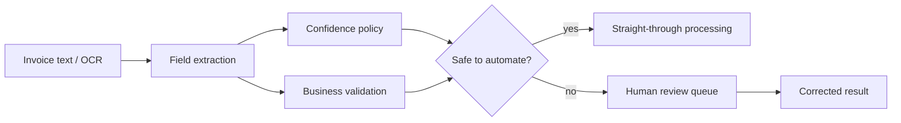

# InvoiceFlow

Intelligent document processing for invoices with structured extraction, business-rule validation, calibrated uncertainty, and human exception routing.



## Highlights

- Extracts invoice number, supplier, date, total, and currency
- Normalizes dates, decimal separators, and currency symbols
- Separates field confidence from deterministic business validation
- Routes missing, invalid, or uncertain fields to a review queue
- Provides a FastAPI service and CLI
- Benchmarks field accuracy, document latency, and estimated processing cost against a regex baseline

## Quickstart

```bash
python -m venv .venv
source .venv/bin/activate
pip install -e '.[dev,api]'
invoiceflow samples/invoice.txt
invoiceflow-benchmark
pytest
uvicorn invoiceflow.api:app --reload
```

OpenAPI is available at `http://localhost:8000/docs`.

## Measured comparison

| Extractor | Field accuracy | Mean processing time | Estimated cost / 1k |
| --- | ---: | ---: | ---: |
| Baseline | 20% | 0.0039 ms | $0 |
| InvoiceFlow enhanced | 100% | 0.0254 ms | $0 |

The labeled benchmark covers five target fields across multiple date, decimal, total-label, and currency formats.

## Benchmark integrity

`invoiceflow-benchmark` evaluates both extractors on the same labeled fixture set and writes measured results to `benchmarks/results.json`. The deterministic enhanced extractor has zero inference-token cost; an OCR or LLM adapter can be added while keeping the validation and review pipeline unchanged.

## Privacy

The default implementation runs locally and sends no invoice data to external services.
